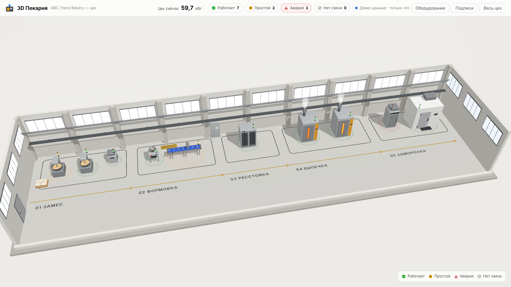
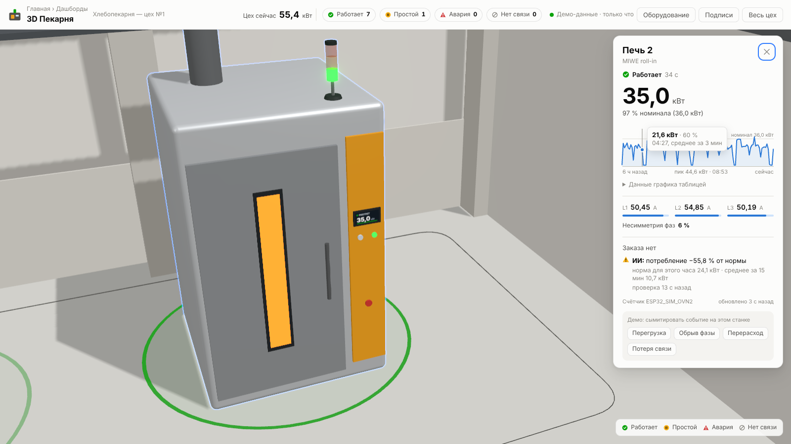

# Цифровой двойник хлебопекарни

3D-схема цеха с живыми данными по энергопотреблению станков: этапы 01 Замес → 02 Формовка → 03 Расстойка → 04 Выпечка, над каждым станком светофор (зелёный — работает, жёлтый — простой, красный — авария или аномалия, погашен — нет связи), по клику — карточка с мощностью, % от номинала, графиком за 6 часов, токами L1/L2/L3, несимметрией фаз и ИИ-проверкой.



**Текущий этап:** работает только фронтенд на демо-данных, которые генерируются прямо в браузере. Бэкенд (API, InfluxDB, Grafana) отложен — см. [ADR-0001](docs/adr/0001-frontend-first-with-in-browser-mock.md) и [следующие шаги](#ближайшие-шаги).

## Запуск с нуля

Нужен только **Node.js 20+** (проверено на Node 22 и 25). Docker для фронта не нужен.

```bash
git clone <репозиторий> bakery-digital-twin   # или просто откройте папку
cd bakery-digital-twin
npm install
npm run dev
```

Откройте http://localhost:5173.

**Windows:** двойной клик по `scripts\start-dev.bat` — он проверит Node.js, при первом запуске выполнит `npm install` и откроет браузер.

Другие команды:

| Команда | Что делает |
|---|---|
| `npm test` | все unit-тесты (vitest) |
| `npm run typecheck` | проверка типов во всех пакетах |
| `npm run build` | production-сборка фронта в `web/dist` |
| `npm run dev:sim` | симулятор счётчиков → MQTT (нужен `docker compose up -d`) |

## Что умеет интерфейс

- **Камера (тачпад MacBook / Windows):** щипок двумя пальцами — приблизить/отдалить к точке под курсором; два пальца влево-вправо и вверх-вниз — сдвиг по цеху; зажать и тянуть (или ⌥/Alt + два пальца) — поворот. **Мышь:** колесо — масштаб к курсору, левая кнопка — поворот, правая — сдвиг.
- **Наведение** на станок — синий контур и подсказка «Имя · кВт».
- **Клик** — камера подлетает к станку, справа карточка: статус и сколько он длится, мощность (кВт) и % номинала, график за 6 ч (3-минутные средние, пик, линия номинала; наведите или используйте ←/→ для значений; под графиком — таблица), токи L1/L2/L3 с полосками относительно номинального тока, несимметрия фаз, заказ, ИИ-проверка, счётчик и «обновлено N с назад».
- **Демо-события** в карточке: перегрузка, обрыв фазы, перерасход, просадка напряжения, потеря связи — чтобы посмотреть, как выглядит авария.
- **Линии питания:** от щита ЩР-1 по кабельному лотку к каждому станку идёт своя линия. Бегущие штрихи показывают ток (чем быстрее — тем больше загрузка автомата), цвет — состояние линии: синий норма, серый без нагрузки, жёлтый внимание, красный (мигает) авария. Наведение — номер линии и % автомата, клик — карточка линии: диагноз простыми словами, загрузка автомата, токи и напряжение по фазам, кнопка «Открыть станок». Клик по щиту — сводка: общая мощность, нагрузка вводного автомата по фазам и все линии, самые проблемные сверху. Кнопка «Линии питания» в шапке скрывает/показывает кабели.
- **Шапка:** суммарная мощность цеха и число станков в каждом статусе; кнопки «Оборудование» (таблица всех станков, работает с клавиатуры), «Подписи» (имена над всеми станками), «Весь цех» (вернуть общий вид).
- Ссылка на станок: `http://localhost:5173/?eq=oven-1`. `Esc` закрывает карточку.



## Как устроено

```
config/equipment.json      этапы, станки (id, название, этап, номинал кВт, фазы, позиция x/y/z, kind, model), пороги
packages/shared            предметная логика + тесты: TwinEngine, статус, несимметрия, базовая линия, ИИ-проверка, линии питания, модель станков
web                        React + Vite + React Three Fiber + drei: сцена, карточка, источники данных
simulator                  те же модели станков → MQTT bakery/{id}/power (для будущего бэкенда)
docker-compose.yml         Mosquitto, InfluxDB 2, Grafana (для будущего бэкенда)
docs/                      план, MQTT-контракт, ADR, настройки навыков
```

Поток данных сейчас: модель станков (`MachineSim`) → показание → `TwinEngine` (статус, базовая линия, ИИ-проверка, история) → `MockDataSource` → сцена и карточки. Сцена знает только интерфейс `DataSource`, поэтому реальные данные подключаются вторым адаптером без переделки UI.

### Логика статусов

| Статус | Когда |
|---|---|
| Работает | мощность ≥ 10 % номинала и нет причин аварии |
| Простой | мощность < 10 % номинала |
| Авария | перегрузка > 115 % номинала · обрыв фазы · несимметрия > 40 % при нагрузке ≥ 30 % · аномалия потребления |
| Нет связи | нет показаний дольше 30 с |

Пороги — в `thresholds` в `config/equipment.json`. Несимметрия — по NEMA ([ADR-0002](docs/adr/0002-phase-imbalance-nema.md)). ИИ-проверка сравнивает среднее за 15 мин с медианой таких же средних в этот час суток за 7 дней и учитывает обычный разброс станка ([ADR-0003](docs/adr/0003-ai-check-robust-statistics.md)).

### Линии питания и диагностика

Щит — `power.panel` в `config/equipment.json` (номер, вводной автомат, место у стены). Автомат и кабель каждой линии подбираются по номинальному току станка с запасом 25 % (`packages/shared/src/feeder.ts`); реальные значения из однолинейной схемы задаются у станка: `"feeder": { "id": "Л-07", "breakerA": 80, "cable": "5×25 мм²" }`. Диагностика линии — `assessLine` в `packages/shared/src/lineHealth.ts`:

| Проблема | Внимание | Авария |
|---|---|---|
| Загрузка автомата (макс. ток / номинал автомата) | > 80 % | > 100 % |
| Обрыв фазы | — | ток по фазе ≈ 0 при нагрузке на других |
| Несимметрия токов | > `imbalanceAlarmPct` при нагрузке ≥ `imbalanceMinLoadPct` | — |
| Просадка напряжения | < 207 В | < 195 В |
| Перенапряжение | > 253 В | > 265 В |

Напряжения пока берутся из модели; с настоящим счётчиком они придут в поле `voltageV` (см. MQTT-контракт).

### Вывеска и логотип компании

`site.brand` в `config/equipment.json`: `name`, `tagline`, `color` (фирменный цвет короба), `logo`. Без `logo` вывеска набирает название объёмными буквами. Если положить SVG-логотип в `web/public/brand/` и указать `"logo": "/brand/<файл>.svg"`, вывеска выдавит контуры логотипа в объёмные световые буквы, а в шапке появится этот же логотип.

### Свой станок или своя 3D-модель

- Новый станок — добавьте запись в `config/equipment.json` (`kind`: mixer, moulder, conveyor, proofer, oven, icemaker, blastfreezer, coldroom или generic); линия питания к нему появится сама.
- GLB вместо процедурной формы — положите файл в `web/public/models/` и укажите у станка `"model": "/models/oven.glb"` (при необходимости `"modelScale": 0.01`). Модель сама встанет на пол, светофор — на её крышу; если файл не загрузится, останется процедурная форма.

## Как подключить настоящий ESP32 вместо симулятора

Формат сообщений уже зафиксирован в [docs/mqtt-contract.md](docs/mqtt-contract.md) (там же пример прошивки на Arduino). Порядок:

1. Поднимите брокер: `docker compose up -d` (Mosquitto на `:1883`).
2. Прошейте ESP32: Wi-Fi + NTP, раз в 5 с публикуйте JSON `{"ts", "meterId", "powerKw", "currentsA": [L1, L2, L3]}` в топик `bakery/<id станка>/power` (id — из `config/equipment.json`).
3. Проверьте поток: `docker exec -it bakery-mosquitto mosquitto_sub -t 'bakery/#' -v`.
4. Чтобы данные дошли до 3D-сцены, нужен сервис API (тикет `.scratch/next-steps/issues/01-…`): он подпишется на эти топики и будет отдавать фронту состояние станков. Фронт для этого уже готов — нужен только второй источник данных вместо демо.

Пока API нет, ESP32 и `npm run dev:sim` пишут только в MQTT, а фронт показывает демо-данные.

## Ближайшие шаги

Черновик тикетов — в `.scratch/next-steps/issues/` (ждут подтверждения):

1. API: живые показания симулятора в 3D-сцене (MQTT → движок двойника → WebSocket).
2. История в InfluxDB: график и базовая линия переживают перезапуск.
3. Первый настоящий счётчик ESP32 на печи.
4. Дашборд «3D Пекарня» в Grafana.
5. GLB-модель печи вместо процедурной формы.
6. Уведомления об аварии в Telegram.
7. 3D-цех внутри Grafana.
8. Заказ в карточке станка из Telegram-бота компании (нужна информация о боте).

## Для разработчиков и агентов

- `CLAUDE.md` — правила работы в репозитории; `GLOSSARY.md` — словарь предметной области; `docs/adr/` — принятые решения.
- Заставка загрузки и пустое состояние «Нет связи» в карточке — фигуры [@lucasmarkes/hairline](https://github.com/lucasmarkes/hairline) (`Slow` — лента с ящиками, `Plug` — вилка не дотягивается до розетки). Версия зафиксирована точно (0.3.0): пакет очень свежий. Навык `hairline-create` нарисует свою фигуру, например печь.
- В `.claude/skills/` лежат навыки [mattpocock/skills](https://github.com/mattpocock/skills) (tdd, code-review, domain-modeling, to-tickets и др.); логика меняется по TDD на стыках, перечисленных в `CLAUDE.md`.
